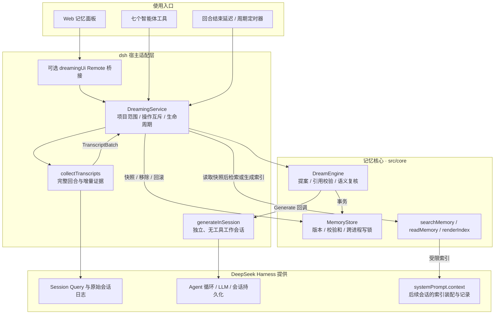
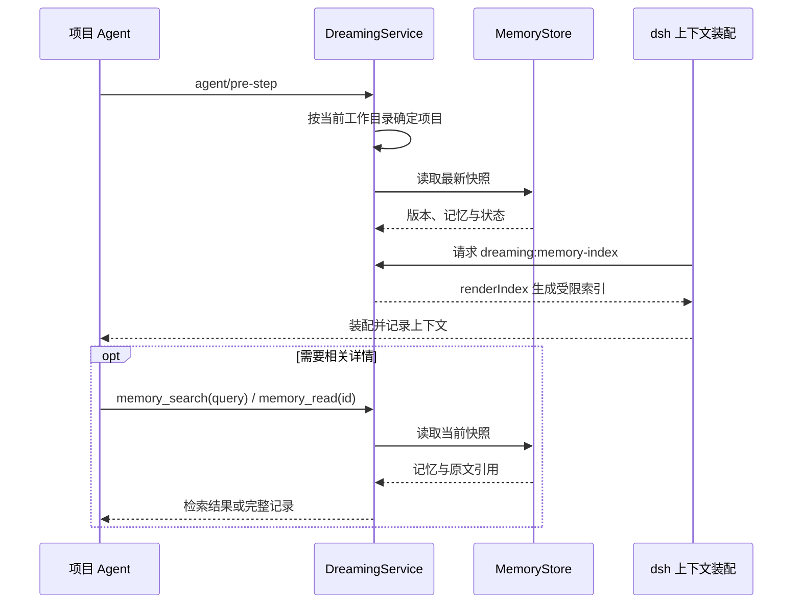

# Dreaming for DeepSeek Harness

**把已完成的项目会话，整理成有来源、可纠正、能回滚的长期记忆。**

[English](README.en.md) · [中文使用说明](README.zh-CN.md) · [兼容说明](docs/compatibility.md) · [验证记录](docs/verification.md)

**Codex 用户：**本仓库还提供独立的 [Dream Trace 插件](codex-plugin/README.md)，通过 Codex hooks 采集证据、MCP 检索与复盘，共享下述记忆核心。运行 `npm run pack:codex` 可构建独立安装包，无需安装 dsh。[Codex 验证记录](docs/codex-verification.md)。

Dreaming 是一个面向 **DeepSeek Harness（dsh）** 的社区插件。它回看项目内已完成的会话，提炼操作经验、项目决策、偏好、事实和踩坑记录；后续会话先获得一个简短索引，再按需检索详细内容。每条记忆带有原文引用，内容和处理进度一起保存为可恢复的版本。

插件通过 dsh 的 Agent 循环调用已配置的模型，不训练模型或修改模型权重，也不属于 DeepSeek 或 Anthropic 官方产品。

| 项目 | 当前实现 |
|---|---|
| 插件版本 | `0.3.1` |
| 兼容基线 | **DeepSeek Harness `0.2.2-rc.1`** |
| 运行环境 | Node.js `>=24.9.0` |
| 使用入口 | Web 侧栏「记忆」、七个智能体工具、可选后台任务 |
| 存储与检索 | 项目隔离的本地 JSON 版本文件；关键词与中文子串检索 |
| 默认行为 | 项目列表为空，自动复盘关闭，语义复核开启 |
| 许可证 | [MIT](LICENSE) |

[快速开始](#快速开始) · [整体架构](#整体架构) · [复盘流程](#复盘流程) · [后续会话如何使用记忆](#后续会话如何使用记忆) · [工具与配置](#工具与配置) · [数据与恢复](#数据与恢复) · [开发与验证](#开发与验证)

## 快速开始

### 1. 构建并安装

先准备兼容版本的 dsh，并在 dsh 中配置可用模型与凭据。在本仓库目录执行：

```sh
npm ci
npm run check
npm pack
dsh plugin --profile web add /absolute/path/dsh-plugin-dreaming-0.3.1.tgz
```

把包路径替换为实际生成文件的绝对路径。这里以现有 `web` 配置为例；使用其他配置时，安装和启动须选择同一个配置。更新已安装的代码后，重启 dsh 并刷新浏览器。

### 2. 启用项目

默认 `projectRoots: []`，不会读取任何项目历史。创建 `dreaming.patch.yml`，填入实际存在、互不重叠的项目绝对路径：

```yaml
- id: dsh-plugin-dreaming
  config:
    projectRoots:
      - /absolute/path/to/your-project
    storageDirectory: /absolute/path/to/dreaming-data
    provider: deepseek-official
    model: deepseek-flash
    verify: true
    autoRunAfterTurn: false
    autoRunIntervalMinutes: 0
```

启动 Web 配置：

```sh
dsh web --patch /absolute/path/to/dreaming.patch.yml
```

`provider` 和 `model` 必须对应 dsh 中可用的模型路由。凭据由 dsh 管理；启用项目意味着允许将采集到的该项目历史发送给配置的模型提供方。

### 3. 完成一轮对话并复盘

在启用的项目中完成至少一轮对话，再打开侧栏「**记忆**」，选择项目并点击「**开始复盘**」。也可以让智能体调用 `dream_run`。当前尚未结束的回合会留到下一次复盘。

面板支持中英文与明暗主题，可以搜索和筛选记忆、查看原文证据、移除记录及恢复历史版本。工具或后台任务更新数据后，点击「刷新」读取最新状态。具体操作见[中文使用说明](README.zh-CN.md#在界面中查看和管理记忆)。

需要自动复盘时，设置 `autoRunAfterTurn: true`，或把 `autoRunIntervalMinutes` 设为正数。定时任务只在 dsh Host 运行期间执行；重启后可按持久化游标继续，但不会补跑错过的每个定时点。

## 整体架构

项目采用 **dsh 宿主适配层 + 独立记忆核心 + 可选 Web 客户端** 的结构。`DreamingService` 是统一操作入口；`src/core/` 不依赖 dsh 服务，通过注入的 `Generate` 函数请求模型。会话日志、Agent 循环和上下文装配由 dsh 提供，派生记忆由插件单独存储。



### 模块职责与代码入口

| 模块 | 职责 | 源码 |
|---|---|---|
| 服务编排 | 规范化项目目录、建立独立存储、协调复盘/读写、注册触发器、取消与卸载清理 | [src/index.ts](src/index.ts) |
| 配置 | Cordis 配置声明与运行时严格校验、默认值和预算约束 | [src/config.ts](src/config.ts) |
| 会话采集 | 查询原始事件，按完整回合选取增量证据，过滤跨项目和派生内容 | [src/transcripts.ts](src/transcripts.ts) |
| 记忆引擎 | 分配输入预算、生成提案、校验引用、语义复核、应用变更和游标 | [src/core/engine.ts](src/core/engine.ts) |
| 模型适配 | 创建单次响应的工作会话，禁用工具，等待日志持久化并释放会话资源 | [src/worker.ts](src/worker.ts) |
| 版本存储 | 写锁、校验和、原子发布、历史遍历、移除与回滚 | [src/core/store.ts](src/core/store.ts) |
| 数据与召回 | 记忆/引用/提案类型、关键词检索、按 ID 读取、受限索引、凭据模式检查 | [types.ts](src/core/types.ts) · [index.ts](src/core/index.ts) · [security.ts](src/core/security.ts) |
| 智能体工具 | 注册七个工具，将调用会话映射到允许的项目 | [src/tools.ts](src/tools.ts) |
| Web 接口 | 所有者权限、准确项目根目录校验、Host/Client 共用的请求与结果协议 | [ui-bridge.ts](src/ui-bridge.ts) · [ui-protocol.ts](src/ui-protocol.ts) |
| Web 客户端 | React 面板、项目切换、本地筛选、证据详情和管理操作 | [client/source.js](client/source.js) · [locale/](locale/) |

Web 通过 dsh 已有的类型化 Remote 通道调用 `dreamingUi`，不单独启动 HTTP 服务。桥接仅在 `typert` 可用时注册，因此终端或无界面配置仍可使用工具、后台复盘和索引注入。浏览器只允许已认证的 Harness 所有者选择配置内的准确项目根目录；工具根据调用会话的当前工作目录确定项目，没有跨项目路径参数。

### 并发与生命周期

同一项目的 `run`、`forget`、`rollback` 共用服务内互斥控制；重叠的手动操作返回 `BUSY`，后台触发遇到忙碌项目则跳过。不同项目使用不同存储和操作状态。

跨进程写入再由 `MemoryStore` 的写锁保护。**提取和语义复核的模型调用也在写锁内执行**，使提案始终针对锁内读取的当前版本；代价是同项目其他写操作须等本次运行结束后重试。读取仍可获得已发布快照。

超时、调用方取消和插件卸载合并为同一个取消信号。卸载会取消工作会话、清理定时器并等待进行中的操作结束，已发布的数据保留。`running` 和 `lastRun` 是当前进程状态；记忆、游标和版本历史才是持久化状态。

## 复盘流程

一次运行只处理一个受会话数、事件数和字符预算约束的批次。处理游标 `cursors[sessionId]` 记录已处理完整前缀的结束事件序号，记忆引用则记录具体的 `sessionId`、`seq` 和原文片段。

1. **采集完整回合。** 服务读取已有游标并预留旧记忆、引用和复核提案所需空间，再采集允许项目内尚未处理的回合。超出本批容量的后续回合留到下次；首个待处理完整回合本身装不下时明确报错，不截断文本或跳过游标。
2. **取得写锁并重读状态。** 引擎使用最新游标排除已被其他写入处理的前缀。没有新前缀时直接返回，不调用模型、不创建版本。
3. **提取并校验提案。** 有可用证据时，独立工作会话接收旧记忆、历史引用和新事件，返回新增、修正或退役的 JSON 提案。程序检查结构、长度、数量、引用原文和可识别凭据；来源类型与观察时间由宿主补齐。
4. **按需语义复核。** 默认 `verify: true`，仅在提案有实际变更时，再用同一 provider/model 的独立工作会话检查引用能否支持结论。两个工作会话都禁用工具执行，输入输出保存在普通 dsh 会话日志中。
5. **一起发布记忆和游标。** 校验全部通过后，在同一版本中写入内容和处理进度。没有可用文本或模型返回空提案时，也会记录已处理前缀，避免下次重复消耗同一批证据。

采集器排除子代理与 Dreaming 工作会话、分叉继承历史、合成的中断/分叉结束回合、注入上下文及插件自身的工具调用和结果；仅提取可见文本，不包含私有推理、图片或不透明数据。项目范围过滤和常见凭据脱敏在模型调用前执行。

### 结果与可信程度

| 运行结果 | 含义 |
|---|---|
| `unchanged: true` | 没有新前缀被处理；未调用模型，也未创建版本 |
| `unchanged: false`，变更计数均为 0 | 已处理新前缀并发布版本，但只推进了游标 |
| `created` / `updated` / `retired` 大于 0 | 对应数量的记忆已随新版本发布 |
| `deferred: true` | 采集时发现后续完整回合超出本批预算；需再次手动运行或等待下一次自动触发 |

`supported` 表示引用支持限定范围内的陈述；`uncertain` 保留不确定性，两者都属于有效记忆。仅有助手断言不能建立 `supported` 记忆。`stale` 表示已退役，不进入工具搜索和自动索引，但仍可在面板或按 ID 读取时查看。

原文匹配证明引用存在，语义复核检查解释是否合理；两者都不保证模型结论永久正确。

## 后续会话如何使用记忆

在匹配项目的 `agent/pre-step` 阶段，服务读取最新快照，通过 `systemPrompt.context` 提供受限索引。每条带有 ID、层级、标题与证据状态。层级决定哪些结论随请求加载，实际注入内容可以在 dsh 会话日志中查看。

| 层级 | 适用范围与例子 | 进入上下文的方式 |
|---|---|---|
| L1 全局通用 | 用户明确共享给本插件所有已启用项目的约定 | 优先加载有据可查的短结论 |
| L2 项目配置 | 当前项目的服务器地址、工具链或用户习惯 | 有据可查时直接加载短结论 |
| L3 关键经验 | 漏掉会导致发布失败的构建顺序 | 有据可查时直接加载短结论 |
| L4 常规经验 | 可复用的普通操作 | 索引展示标题，按需读取 |
| L5 备查细节 | 低频排错细节 | 通过搜索、按 ID 读取或在面板查看 |

复盘可以调整 L2–L5。旧记录首次读取时按 L4 处理。只有在来源项目显式选择 L1 才会共享，其他项目可读结论，原始证据留在来源项目。可以在 Web 记忆详情的「记忆层级」中改级，也可以让智能体调用 `memory_set_level`。降级、移除或退役会在下一次读取时停止共享；回滚会恢复当时的共享状态。复盘改写已共享的标题或正文后，新内容回到项目内。

在 dsh Web 的经验详情关闭「允许智能体使用」，会暂停后续索引、搜索和按 ID 读取。管理页保留正文与证据，勾选「只看已暂停」可找到记录并恢复。暂停来源项目的 L1 会停止所有项目召回它；在接收项目暂停继承的 L1 只影响当前项目。可见性独立于层级，回滚记忆版本时保留当前选择。已送入聊天的历史内容仍在原会话中。

自动加载受 `maxIndexChars` 总预算约束。超过 360 字符或无法完整放入的结论退回标题；待确认也只显示标题。同标题的已证实 L2 配置在索引中覆盖 L1 默认值，搜索仍可找到两条记录。



当前没有向量数据库。`memory_search` 对有效记忆的标题和内容进行关键词与中文子串匹配，先按命中数排序，命中数相同再比较层级、证据状态和更新时间；Web 搜索在已加载快照中匹配标题、内容和证据原文。两种搜索的范围不同，记忆文本始终应作为可核对的历史数据使用。

## 工具与配置

七个工具与 Web 页面复用同一套服务操作。移除和回滚用于用户要求的管理操作，页面执行前会要求确认。

| 工具 | 参数 | 用途 |
|---|---|---|
| `dream_run` | 无 | 对当前项目执行一批复盘 |
| `dream_status` | 无 | 查询当前版本、运行状态、最近操作结果及可回滚版本 |
| `memory_search` | `query`、可选 `limit` | 搜索有效记忆；空查询列出有效记录，受返回条数限制 |
| `memory_read` | `id` | 读取完整记忆及证据，包括退役记录 |
| `memory_set_level` | `id`、`level`、可选 `expectedRevision` | 调整来源项目记忆的层级；共享为 L1 时须传当前版本 |
| `memory_forget` | `id` | 从当前版本移除记忆，保留历史版本 |
| `dream_rollback` | `revision` | 把已提交历史版本的内容和游标恢复为新版本 |

完整配置见[中文配置表](README.zh-CN.md#配置)，校验规则见 [src/config.ts](src/config.ts)。以下参数决定主要行为：

| 配置 | 默认值 | 作用 |
|---|---|---|
| `projectRoots` | `[]` | 允许读取的项目范围，需存在且互不重叠 |
| `storageDirectory` | `$DSH_HOME/dreaming` 或 `~/.dsh/dreaming` | 插件自己的数据目录 |
| `provider` / `model` | `deepseek-official` / `deepseek-flash` | 提取和复核的模型路由 |
| `autoRunAfterTurn` / `afterTurnDelaySeconds` | `false` / `30` | 回合结束后延迟复盘，连续触发合并等待 |
| `autoRunIntervalMinutes` | `0` | 周期复盘；0 表示关闭 |
| `verify` | `true` | 对实际记忆变更进行独立语义复核 |
| `maxSessionsPerRun` / `maxEventsPerRun` | `10` / `2000` | 每批选入的会话数与证据事件数上限 |
| `maxInputChars` / `maxProposalChars` | `60000` / `12000` | 每次模型输入 JSON 数据与提案的字符上限 |
| `maxFacts` / `maxFactsPerRun` | `100` / `20` | 有效记忆总数与每批变更数上限 |
| `maxIndexChars` | `4000` | 自动注入索引的字符上限 |
| `maxOutputTokens` | `6000` | 每个工作会话的模型输出上限 |
| `runTimeoutSeconds` | `180` | 单次写操作超时，包含采集、模型调用和提交 |

字符预算不等于计费 token 限额，也不包括固定系统提示等开销。`maxSessionsPerRun` 限制选入批次的会话数，不保证底层只读取这么多个会话。旧记忆和历史引用也占用输入空间，退役记录不计入 `maxFacts`。

## 数据与恢复

规范化后的项目路径通过 SHA-256 映射到独立子目录。一个 `MemoryState` 保存记忆 `facts`、会话游标 `cursors` 和版本元数据；每条记忆保留分类、状态、创建/更新时间及带来源类型和观察时间的引用。

```text
storageDirectory/
└── <sha256-of-canonical-project-path>/
    ├── current.json        # 当前版本号与内容校验和
    ├── revision-1.json     # 记忆、游标、父版本号及父版本校验和
    ├── revision-2.json
    └── .writer.lock/       # 写入期间的跨进程锁
```

存储先写入版本文件，再原子替换 `current.json` 指针；已提交版本不被修改，历史沿父版本及校验和验证。提取、引用校验或语义复核失败时不会发布版本，也不会推进游标。发布指针后发生持久化或锁释放异常时，可能返回 `COMMIT_UNKNOWN`，须重新读取状态再判断是否重试。

`memory_forget` 保留游标，避免同一段已处理历史立刻重新生成被移除的记忆。回滚创建新版本，并恢复目标版本的内容和游标，因此后续历史可能再次被处理。两者都保留旧版本和原始会话，不等于安全擦除。当前不自动裁剪历史版本，也不维护额外的 Markdown 副本。

### 常见状态与处理

| 状态或错误 | 处理方式 |
|---|---|
| 面板没有项目 / 目录未启用 | 检查 `projectRoots`，并确认启动时加载了对应配置 |
| `unchanged: true` | 确认项目内已有新完成的回合；正在进行的回合不会被采集 |
| `BUSY` | 等待当前项目的写操作结束后重试 |
| `BUDGET_EXCEEDED` / `INPUT_LIMIT` | 按错误提示增加输入或事件预算，或减少旧记忆和提案预留占用 |
| `INVALID_PROPOSAL` / `UNSUPPORTED_EVIDENCE` / `REVIEW_REJECTED` | 查看提取或复核工作会话；本批尚未发布，可在排查后重试 |
| `COMMIT_UNKNOWN` / 写请求响应中断 | 先刷新或调用 `dream_status` 核对已发布版本，再决定下一步 |

## 开发与验证

项目使用 TypeScript、Cordis、Zod、React 和 esbuild。服务端构建与客户端构建使用不同入口：

| 输入 | 输出 / 加载方式 |
|---|---|
| `src/**/*.ts` | `tsc` 生成 `lib/` 下的 ESM、类型声明和 source map；包入口为 `lib/index.js` |
| `client/source.js` + `src/ui-protocol.ts` + `locale/*.json` | esbuild 生成发布用 `client.js`；React 由 dsh 浏览器模块表提供 |
| `cordis.patch.yml` | 安装包的 Host 插件配置层，默认项目列表为空 |
| `package.json` 中的 `dsh.client` | 声明 Web 客户端及 remotes、locale、layout、sidebar 依赖 |

修改界面应编辑 `client/source.js`，再运行构建生成 `client.js`。本地检查命令与 CI 一致：

```sh
npm ci
npm run check
node scripts/verify-package.mjs
```

`npm run check` 依次执行类型检查、测试和构建；安装包核验单独执行，检查打包文件、元数据、真实 ESM 入口及 Client 工厂。测试采用脚本化模型适配器，不需要在线密钥。

| 测试文件 | 主要覆盖范围 |
|---|---|
| [config.test.ts](tests/config.test.ts) | 默认值、路径格式、未知字段和预算约束 |
| [core.test.ts](tests/core.test.ts) | 引用、复核、修正/退役、游标、预算、写锁、校验和与恢复 |
| [transcripts.test.ts](tests/transcripts.test.ts) | 完整回合、项目/符号链接隔离、分叉历史和内容过滤 |
| [runtime.test.ts](tests/runtime.test.ts) | 真实 dsh Agent 循环、持久化工作会话、召回、工具、取消和卸载 |
| [ui-bridge.test.ts](tests/ui-bridge.test.ts) | Client/Host 通道、权限与协议校验、共用操作和客户端激活 |

已有的 **2026-11-08 验证记录**包含 55 项测试、真实 dsh Web 页面检查，以及一次合成项目指令的在线模型提取与复核。具体环境、用量和边界见[验证记录](docs/verification.md)；这些结果证明所测流程可运行，不代表长期记忆质量基准。自动化检查配置见 [GitHub Actions](.github/workflows/ci.yml)，远程运行结果以实际 CI 为准。

## 当前边界

兼容声明限定于 dsh `0.2.2-rc.1`，升级 Harness 后需重新验证。当前没有知识 Wiki、图谱可视化、向量检索、跨项目共享或历史版本自动裁剪。

项目隔离采用保守规则：只读取创建于允许目录的会话；回合中切换到项目外，则排除整个回合；在其他项目创建后才切入本项目的会话也不会读取。移动项目目录需要显式重新配置，旧记忆不会自动迁移。

识别式脱敏无法发现所有秘密，原始会话、模型工作会话和历史版本可能保留敏感内容。涉及版本或时间的记忆仍应与当前证据核对。

## 参考与许可

- [DeepSeek Harness](https://github.com/deepseek-ai/deepseek-harness)：插件依赖的运行环境。
- [Anthropic — Components of agent memory](https://www.anthropic.com/research/components-of-agent-memory)：dreaming 与分层记忆的设计参考。
- [MIT License](LICENSE)：本项目许可证。
